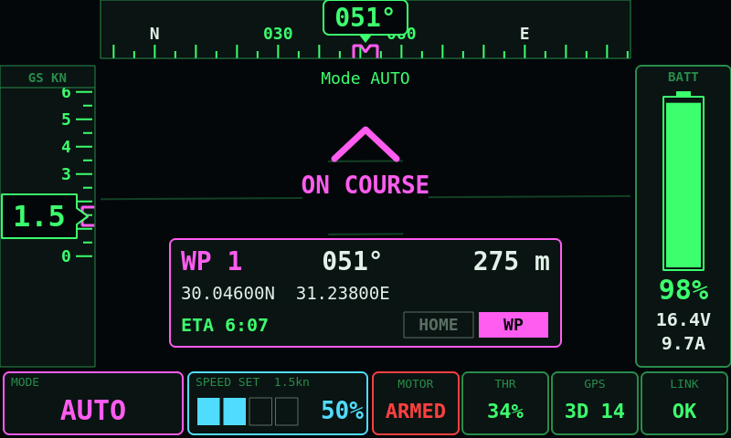

# DPV Driver HUD

A heads-up-display style dashboard for the DPV driver. It runs on a Raspberry Pi 5 with a 5" HDMI screen. At power-on the Pi boots straight into a full-screen dashboard that shows speed, battery, driving mode and heading guidance read from the Pixhawk autopilot (ArduPilot Rover/Boat). The driver controls it with hall-effect push buttons. There is no touch input.



---

## 1. How it fits together

```
 ┌──────────────┐  USB (MAVLink2, /dev/ttyACM0)    ┌──────────────────────── Raspberry Pi 5 ──────────────────────────┐
 │   Pixhawk    │ ───────────────────────────────▶ │ mavlink_link.py (thread)                                         │
 │  ArduPilot   │   telemetry: speed, heading,     │   └─▶ VehicleState ──▶ hud.py (draws 30×/s) ──▶ HDMI ──▶ 5" LCD  │
 │ Rover / Boat │   battery, GPS, mode, mission    │                                                                  │
 │              │ ◀─────────────────────────────── │ controller.py ◀── controls.py ◀── hall buttons (GPIO 5/6/13/19)  │
 └──────────────┘   commands: set mode, change     │   └─ throttle.py: RC throttle override, 10×/s                    │
                    speed, RC throttle override    └──────────────────────────────────────────────────────────────────┘
```

- **`mavlink_link.py`** talks to the Pixhawk on a background thread. It asks the Pixhawk to stream the messages we need, downloads the mission, and keeps one `VehicleState` up to date. Commands from the UI are queued and sent from this thread.
- **`hud.py`** reads a snapshot of that state 30 times a second and draws the whole screen.
- **`controls.py`** turns GPIO button edges into `pressed`/`released` events. **`controller.py`** decides what each button does.
- **`throttle.py`** acts as the vehicle's "RC transmitter" for the throttle channel (see §5).
- **`sim.py`** is a fake vehicle with the same interface as the real link. It lets you work on the HUD with no Pixhawk attached.
- **`blackbox.py`** records every run: all MAVLink traffic, what the HUD showed and what the driver pressed (see §10).

Section §9 describes every file in detail.

## 2. Hardware and wiring

| Item | Notes |
|---|---|
| Raspberry Pi 5, Raspberry Pi OS (Debian 13 "trixie"), desktop | Logs in automatically as `dpv` into the labwc (Wayland) desktop |
| 5" 800×480 HDMI LCD | Plug-and-play over HDMI on the Pi 5. **Do not run the vendor's `LCD-show` / `LCD5-show` script.** It was written for older Pis and the legacy display driver. It rewrites `config.txt` and can leave you with a black screen. |
| Pixhawk running ArduPilot Rover (boat frame) | Pixhawk's USB port → any Pi USB port |
| Hall-effect push buttons | On Pi GPIO, one per function |

**Pixhawk → Pi over USB.** The Pixhawk appears as `/dev/ttyACM0`. `config.toml` tries the stable name `/dev/serial/by-id/usb-…-if00` first, so the right port is found even if other USB serial devices are plugged in. To see the board's exact name, run `ls /dev/serial/by-id/` with it connected.

- Power the Pixhawk from its own power module. USB power from the Pi is fine on the bench but not for driving.
- The Pi 5 needs a proper **5 V / 5 A** supply. If `vcgencmd get_throttled` shows anything other than `0x0`, the Pi has been undervolted. On the bench it showed `0x50005` at 4.8 V while it also powered the Pixhawk. Undervoltage can reset the USB port, and the HUD then shows NO LINK.
- Use a short, good-quality cable, and strain-relieve it: if the cable comes loose, the motor stops (see §5).

**Buttons** (BCM numbers, set in `config.toml`)

| Function | GPIO | Header pin |
|---|---|---|
| MODE | 5 | 29 |
| SPEED | 6 | 31 |
| TRIGGER (dead-man) | 13 | 33 |
| GUIDE | 19 | 35 |
| Ground | – | 30, 34 or 39 |

**Wiring the A3144E hall switches.** Hold the sensor with the printed (bevelled) face toward you and the legs pointing down. From left to right the legs are **1 = VCC, 2 = GND, 3 = OUT**.

| A3144 leg | Connect to |
|---|---|
| 1 VCC | Pi **5 V** (pin 2 or 4). The A3144 needs **4.5–24 V**, so 3.3 V is out of spec. |
| 2 GND | Pi GND (pin 30, 34 or 39) |
| 3 OUT | The button's GPIO (table above), **plus a 10 kΩ resistor from OUT to 3.3 V** (pin 1 or 17) |

Add a 100 nF capacitor across VCC–GND, close to each sensor.

- OUT is **open-collector**. It can only pull the line down to GND and never drives it up, so a 5 V supply is safe as long as the pull-up goes to **3.3 V**. ⚠️ **Never pull OUT up to 5 V. A GPIO pin must never see more than 3.3 V.** The Pi's internal pull-up (~50 kΩ, enabled by the app) works on the bench, but the external 10 kΩ makes the line much less sensitive to motor noise.
- The A3144 is **unipolar**. It switches on only when a magnet's **south pole** faces the printed side, and switches off again when the magnet moves away. If a button doesn't react, turn the magnet over.
- It is **fail-safe**. A broken wire or an unpowered sensor leaves the line high, which reads as "released", so a cut TRIGGER wire stops the motor. Only a short from OUT to GND reads as "pressed".
- `active_high = false` (the default) is correct for the A3144.

## 3. Reading the HUD

| Where | What |
|---|---|
| **Top: heading tape** | A compass ribbon. The box shows the current heading. It turns **amber** with **TILT** when roll or pitch exceeds 70° (a compass heading is meaningless near vertical), or with **AHRS** when the autopilot reports its attitude estimate as unhealthy. The **bug** on the tape marks the bearing to the selected guidance target. When the target is off the tape, an arrow at the edge points toward it. |
| **Left: speed tape** | Ground speed (knots by default). In AUTO/RTL a magenta bug marks the commanded speed. Shows `--.-` / NEEDS GPS without a 3D GPS fix, because without GPS the number would be an estimate, not a measurement. |
| **Right: battery** | Remaining %, voltage and current. Green above 40 %, amber above 20 %, **red and flashing** at 20 % or less. **NO BATT**: a monitor is configured but the voltage is below `[battery] min_valid_v`, so nothing (real) is connected. **NO MON**: no battery monitor (`BATT_MONITOR = 0`). Note that ArduPilot does not *measure* the %. It counts down from `BATT_CAPACITY` starting at FC power-up, so plug in a full pack before powering the Pixhawk. |
| **Centre: steering cue** | Chevrons point the way to turn, and the number is the error in degrees. 1 chevron means under 20°, 2 means under 60°, 3 means 60° or more. Within 5° it shows **ON COURSE**; within 3 m of the target it shows **AT HOME** / **AT WP n**. |
| **Centre: guidance box** | The selected target (**HOME** in cyan, or **WP n** in magenta) with its bearing, distance, coordinates and ETA. The HOME/WP tabs show which target is selected. |
| Under the heading tape | The latest message from the autopilot (shown for 10 s). Red = error, amber = warning. |
| **Bottom: MODE** | The current mode. A mode that is selected but not yet sent flashes amber (see §4). |
| **Bottom: SPEED SET** | The selected speed level. In AUTO/RTL it also shows the speed this works out to. |
| **Bottom: MOTOR / THR / GPS / LINK** | Armed state, actual throttle output (lit green while the trigger is held), GPS fix and satellite count, and the link to the Pixhawk. |
| **NO LINK** banner | No heartbeat from the Pixhawk for 2 s. All readings are blanked (dashes) rather than left showing stale values. |
| Grey dashes anywhere | That value is **unknown right now**: not received yet, not refreshed recently, or physically implausible. The HUD never shows a default or a remembered value as if it were live (see "Trust rules" in §9). |

Colours follow cockpit convention: green = normal, cyan = home and selections, magenta = active route, amber = caution, red = warning.

## 4. Buttons

| Button | Press | Notes |
|---|---|---|
| **MODE** | Steps the *pending* mode MANUAL → AUTO → RTL → … | The pending mode flashes. It is only sent to the Pixhawk after **1.5 s with no further presses**, so one accidental bump can't trigger RTL. To get to RTL from MANUAL, press twice and wait. |
| **SPEED** | Steps the level 25 → 50 → 75 → 100 % → 25 … | In MANUAL this is the throttle used while the trigger is held. In AUTO/RTL it is sent straight to the autopilot as level × `WP_SPEED`, and it is re-sent every time AUTO/RTL is entered. |
| **TRIGGER** | Hold to drive, release to stop | Dead-man switch, **MANUAL mode only**. In AUTO/RTL the autopilot controls the throttle. |
| **GUIDE** | Switches between HOME and WP | **HOME** = the launch point (set by the Pixhawk at arming). **WP** = the active waypoint of the mission uploaded from the land station (Mission Planner / QGC). It works in MANUAL too, so the driver can steer to a waypoint by hand. |

For desk testing, the keyboard does the same: **M** = mode, **S** = speed, **Space** = trigger (hold), **G** = guide, **Ctrl+Q** = quit.

## 5. Safety: how the throttle works

The Pixhawk has **no RC receiver**. The Pi stands in for it on the throttle channel only. While the link is up, the Pi sends an `RC_CHANNELS_OVERRIDE` message **10 times a second**:

- in **MANUAL** with the **trigger held**: `neutral + level % × (full − neutral)`. The defaults are 1500 to 2000 µs, so 50 % = 1750.
- **at any other time**: `neutral` (motor stopped).

Every other channel is marked "ignore", so the Pi never touches steering.

If the app crashes, the Pi freezes or the cable comes off, the overrides stop. ArduPilot drops them after `RC_OVERRIDE_TIME` and treats the situation as radio loss, which triggers its throttle failsafe (`FS_ACTION`, set to Hold = stop). For this reason the Pi keeps sending *neutral* rather than going silent when the trigger is released: going silent would look like radio loss and switch the vehicle to Hold every time the driver let go.

> ⚠️ **Do the first powered tests with the propeller removed or the motor unloaded.** Then confirm three things in the ground station: the SERVO3 output follows the trigger and level; releasing the trigger returns it to neutral; and `pkill -f dpv_dash` stops the motor within about half a second. To use the dashboard for display only, set `[throttle] enabled = false`.

## 6. ArduPilot parameters (set from the land station)

| Parameter | Value | Why |
|---|---|---|
| `SERIAL0_PROTOCOL` | 2 | MAVLink2 on USB (this is the default) |
| `SYSID_MYGCS` (called `MAV_GCS_SYSID` on newer firmware) | 255 | ArduPilot only accepts RC overrides from this system ID; the Pi uses 255. If the land station also sends joystick overrides, give one of them a different ID. |
| `RC_OVERRIDE_TIME` | 0.5 | Overrides expire 0.5 s after the last message. ⚠️ On the bench Pixhawk this was **3**, which means the motor would keep its last throttle for 3 s after the Pi dies. `--check` flags it. |
| `FS_THR_ENABLE` | 1 | Enable the radio/throttle failsafe |
| `FS_ACTION` | 2 | Failsafe action = Hold (stop) |
| `RCMAP_THROTTLE` | 3 | Throttle is RC channel 3 (`[throttle] channel`) |
| `WP_SPEED` | your cruise speed | 100 % speed level in AUTO/RTL |
| `BATT_MONITOR`, `BATT_CAPACITY` | 4, your pack's mAh | Power-module voltage/current; % is counted down from the capacity |

Run `.venv/bin/python -m dpv_dash --check` (§8) to read all of these from the Pixhawk and compare them with this table.

Arming is done from the land station for now. Check that the pre-arm checks pass while the Pi is connected, since its overrides count as the RC input.

## 7. Install and autostart

```bash
cd /home/dpv/dpv_gui
python3 -m venv --system-site-packages .venv     # reuses apt's PyQt5 + gpiozero
.venv/bin/pip install pymavlink

sudo scripts/setup_pi.sh       # disables screen blanking, checks the dialout group
cp deploy/dpv-dash.desktop ~/.config/autostart/
sudo reboot
```

At login, the desktop starts `scripts/run.sh`. That script launches the dashboard full-screen and restarts it 2 s after any crash.

| To… | Run |
|---|---|
| Stop it now | `pkill -f scripts/run.sh; pkill -f dpv_dash` |
| Stop it starting at boot | `touch ~/.config/dpv_dash.disabled` (delete the file to re-enable) |
| Start it again by hand | see §8, step 4 |
| Read the log | `tail -f ~/.local/state/dpv_dash.log` |

## 8. Running it

There are two ways to run the dashboard:

- **Operation mode**: the real thing. It talks to the Pixhawk over USB, and it is what starts automatically at boot.
- **Sim mode** (`--sim`): a fake vehicle that drives around, drains its battery and follows waypoints. Use it to try the HUD and the buttons with no Pixhawk attached. In sim mode **nothing is sent to the Pixhawk**, even if one is plugged in.

All commands below are run from the project folder:

```bash
cd /home/dpv/dpv_gui
```

### Step 1: stop the dashboard that is already running

After boot, the dashboard is already running. Stop it before starting another copy. Otherwise two windows will compete for the screen and for the button GPIO pins.

```bash
pkill -f scripts/run.sh; pkill -f "python -m dpv_dash"
```

### Step 2: start it

From a terminal on the Pi or from an SSH session (either way, it appears on the LCD):

```bash
.venv/bin/python -m dpv_dash --sim        # sim mode
.venv/bin/python -m dpv_dash              # operation mode (Pixhawk on USB)
```

Over SSH the app finds the Pi's desktop session on its own. The desktop must be logged in, which happens automatically at boot.

Useful options (they work in both modes):

| Option | Effect |
|---|---|
| `--windowed` | Normal 800×480 window instead of full screen |
| `--conn URL` | Use a different MAVLink connection, e.g. `--conn /dev/ttyACM1`, or `--conn udpin:0.0.0.0:14550` for ArduPilot SITL on a laptop |
| `-v` | Verbose logging |
| `--test-buttons` | No HUD; prints every hall-button press and release, to check the wiring |
| `--check [--seconds N]` | No HUD. Talks to the Pixhawk with plain pymavlink, bypassing the app's parsing, and prints message rates, the raw value behind every HUD field, sensor health and the §6 parameters, with plain-language verdicts. Stop the dashboard first: only one program can open the serial port. |

> The stop command in Step 1 is meant to be typed in an interactive terminal. Inside a script or `bash -c "…"`, `pkill -f` also matches that shell's own command line and kills it. There, look up the PID with `pgrep -af dpv_dash` and `kill` it instead.

### Step 3: drive it

The hall buttons work in both modes. In sim mode you can also use a keyboard plugged into the Pi; key presses typed over SSH don't reach the window.

| Key | Same as | In sim mode |
|---|---|---|
| **M** | MODE | Wait 1.5 s for the mode to apply. In AUTO the fake vehicle heads for its waypoints; in RTL it heads home. |
| **S** | SPEED | Changes the speed level |
| **Space** (hold) | TRIGGER | In MANUAL, the fake vehicle accelerates while it's held |
| **G** | GUIDE | Switches between HOME and WP |
| **Ctrl+Q** | – | Quit (from SSH: Ctrl+C in the terminal) |

In operation mode, the dashboard shows **NO LINK** until the Pixhawk is plugged in and sending heartbeats. It finds the Pixhawk again automatically if the USB cable is reconnected.

### Step 4: go back to normal

Reboot, or start the autostart launcher again. The launcher always runs operation mode, full screen, and restarts it if it crashes:

```bash
nohup scripts/run.sh >/dev/null 2>&1 &
```

## 9. Project architecture

### 9.1 Threads and data flow

The app runs on three kinds of thread. Each piece of data has exactly one writer.

```
 Pixhawk ═USB═▶ [link thread · mavlink_link.py]
   ▲              bytes ─▶ pymavlink parser (CRC check) ─▶ _handle(msg) ─▶ raw VehicleState
   │              every message in + out ─▶ blackbox mavlink.tlog
   │                                    │
   │                                    │ snapshot(): copy under lock + state.apply_trust()
   │                                    ▼
   │            [Qt main thread]   trusted VehicleState
   │                                    ├─▶ hud.py ........ paints 30×/s ─▶ HDMI ─▶ 5" LCD
   ├── RC override (PWM) ◀── 10×/s ─────├─▶ throttle.py
   ├── set mode / change speed ◀────────├─▶ controller.py ─▶ UiState (speed, mode, guide, trigger)
   │                                    └─▶ blackbox.py ... hud.csv 5×/s, events.log
   │                                                 ▲
   └── heartbeat 1×/s (from link thread)             │ Qt signal pressed/released(name)
                                                     │
 Hall buttons ─GPIO 5/6/13/19─▶ [gpiozero callback threads · controls.py]
```

How one value travels. Take the heading:
1. The Pixhawk sends `VFR_HUD` at 10 Hz, because the app asked for that rate with `MAV_CMD_SET_MESSAGE_INTERVAL`.
2. pymavlink checks the packet's CRC and decodes it in the link thread. The raw packet is also appended to `mavlink.tlog`.
3. `MavlinkLink._handle()` accepts it only if it came from the autopilot's system ID. It stores `heading` and the receive time `rx["VFR_HUD"]`.
4. 30 times a second the HUD calls `snapshot()`. That copies the state under a lock and runs `apply_trust()`, which sets `heading = None` if no `VFR_HUD` arrived in the last 1 s.
5. `hud.py` draws the number, or `---°` for `None`. `blackbox.py` writes the same trusted value to `hud.csv`.

**Trust rules** (`state.apply_trust`). A value is shown only when it is fresh *and* plausible. Anything else becomes `None`, which is drawn as grey dashes:

| Value | Shown only if… |
|---|---|
| everything | the link is up (a heartbeat within `link_timeout_s`) |
| speed, heading, throttle | `VFR_HUD` arrived within 1 s; speed also needs a 3D GPS fix |
| roll, pitch (horizon) | `ATTITUDE` arrived within 1 s |
| position | `GLOBAL_POSITION_INT` arrived within 2 s and there is a 3D GPS fix |
| GPS fix / satellites | `GPS_RAW_INT` arrived within 3 s |
| battery V / A / % | `SYS_STATUS` arrived within 3 s, a monitor is configured, and voltage ≥ `[battery] min_valid_v` |

### 9.2 What each file is

| File | What it is / represents | Inputs → outputs | Runs on |
|---|---|---|---|
| `dpv_dash/__main__.py` | **Entry point.** Parses the command line, loads `config.toml`, creates every part below and connects them, starts Qt. Also runs the `--check` and `--test-buttons` tools. | args + config → running app | main thread |
| `dpv_dash/state.py` | **The data model.** `VehicleState` = what the vehicle reported (telemetry). `UiState` = what the driver has selected (speed level, pending mode, guide source, trigger). `apply_trust()` = the trust rules above. Also the navigation maths (bearing/distance). | — | shared |
| `dpv_dash/mavlink_link.py` | **The Pixhawk link.** Opens the serial port, sends our heartbeat, asks for message streams, downloads the mission, decodes incoming messages into `VehicleState`, and sends queued commands (set mode, change speed, RC override). Reconnects automatically. Attaches the blackbox `.tlog`. | serial bytes ⇄ `VehicleState` + command queue | link thread |
| `dpv_dash/controls.py` | **The physical buttons.** Turns GPIO edges from the hall sensors into `pressed(name)` / `released(name)` Qt signals. | GPIO pins → Qt signals | gpiozero threads |
| `dpv_dash/controller.py` | **What the buttons mean.** MODE (with a 1.5 s commit delay), SPEED level, TRIGGER, GUIDE. Re-applies the AUTO/RTL speed whenever the mode changes. Logs every press. | button names → `UiState` changes + link commands | main thread |
| `dpv_dash/throttle.py` | **The virtual RC transmitter** for the throttle channel. Sends `RC_CHANNELS_OVERRIDE` 10×/s: neutral, or level % while the trigger is held in MANUAL. Remembers `last_pwm` for the blackbox. | `UiState` + mode → PWM to link | main thread |
| `dpv_dash/hud.py` | **The screen.** Paints the whole 800×480 HUD from one trusted snapshot, 30×/s. Keyboard fallback for desk tests. | trusted `VehicleState` + `UiState` → pixels | main thread |
| `dpv_dash/blackbox.py` | **The flight recorder.** One folder per run with `mavlink.tlog`, `hud.csv`, `events.log`, `meta.json`. Retention by total size. | messages, snapshots, log lines → files | link + main thread |
| `dpv_dash/check.py` | **Independent link check** (`--check`). Plain pymavlink, without the app's own parsing, to verify what the HUD shows. | Pixhawk → terminal report | standalone |
| `dpv_dash/sim.py` | **Fake vehicle** with the same interface as `MavlinkLink`, run through the same trust rules. | throttle/mode commands → simulated state | sim thread |
| `config.toml` | **All settings**: Pixhawk port, button pins/polarity, battery plausibility, blackbox, speed levels, throttle PWM, mode cycle, units. | — | read at start |
| `scripts/run.sh` | **Autostart launcher.** Runs the app full-screen and restarts it 2 s after a crash. Logs to `~/.local/state/dpv_dash.log`. | — | shell |
| `scripts/setup_pi.sh` | **One-time OS setup**: disables screen blanking, checks the `dialout` group. | — | run once with sudo |
| `deploy/dpv-dash.desktop` | **Autostart entry** for the desktop session; it starts `scripts/run.sh` at login. | — | copied to `~/.config/autostart/` |
| `docs/hud.png` | Screenshot used at the top of this README. | — | — |
| `~/dpv_blackbox/` | **Recorded runs** (not in the project folder). See §10. | — | — |

### 9.3 Development

To take a screenshot of the LCD over SSH: `XDG_RUNTIME_DIR=/run/user/1000 WAYLAND_DISPLAY=wayland-0 grim shot.png`. The autostarted dashboard logs to `~/.local/state/dpv_dash.log`.

## 10. Blackbox

Every start of the app creates `~/dpv_blackbox/<seq>_<date-time>/` (`_sim` is appended in sim mode). The sequence number keeps runs in order even when the Pi boots before its clock has been corrected by NTP: without internet the clock can be off by an hour or more. `meta.json` records whether the clock was synced.

| File | Contents | How to read it |
|---|---|---|
| `mavlink.tlog` | Every MAVLink message **received from** (sysid 1) and **sent to** (sysid 255) the Pixhawk, timestamped. Includes `RC_CHANNELS` / `SERVO_OUTPUT_RAW`, which show that the override arrived and what the motor output did. | Mission Planner / QGC (replay), MAVExplorer (graphs), or `.venv/bin/mavlogdump.py --types VFR_HUD,RC_CHANNELS mavlink.tlog` |
| `hud.csv` | 5 rows/s of exactly what the driver saw (empty cell = shown as dashes), plus speed level, pending mode, guide source, trigger and the throttle PWM sent | Any spreadsheet |
| `events.log` | Link up/lost, button presses/releases, mode and speed commands with the Pixhawk's accept/reject, throttle changes, autopilot messages | Any text editor |
| `meta.json` | Start time, clock-synced flag, boot ID, full config | Text editor |

- Files are flushed to the SD card every 2 s, so a sudden power cut loses at most about 2 s.
- About 9 MB per hour. The oldest runs are deleted when the total passes `[blackbox] max_total_mb` (2000 MB by default).
- This complements the Pixhawk's own **dataflash log** on its SD card, which records the autopilot's internals at high rate. The Pi's blackbox adds what the driver saw and did.

## 11. Adding a button

1. Wire it and add a pin under `[buttons]` in `config.toml`, then add its name to `BUTTON_NAMES` in `dpv_dash/controls.py`.
2. Write the action as a method in `dpv_dash/controller.py` and register it in `self.actions` (on press) or `self.release_actions` (on release).
3. Optionally, map a key in `KEYMAP` in `dpv_dash/hud.py` for desk testing.
